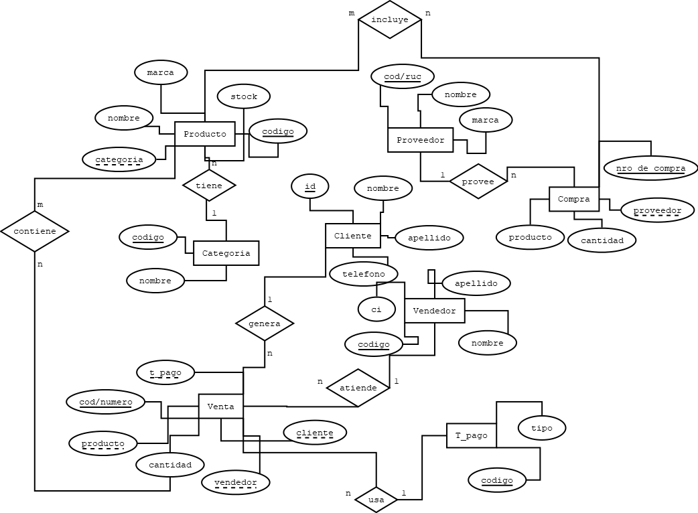
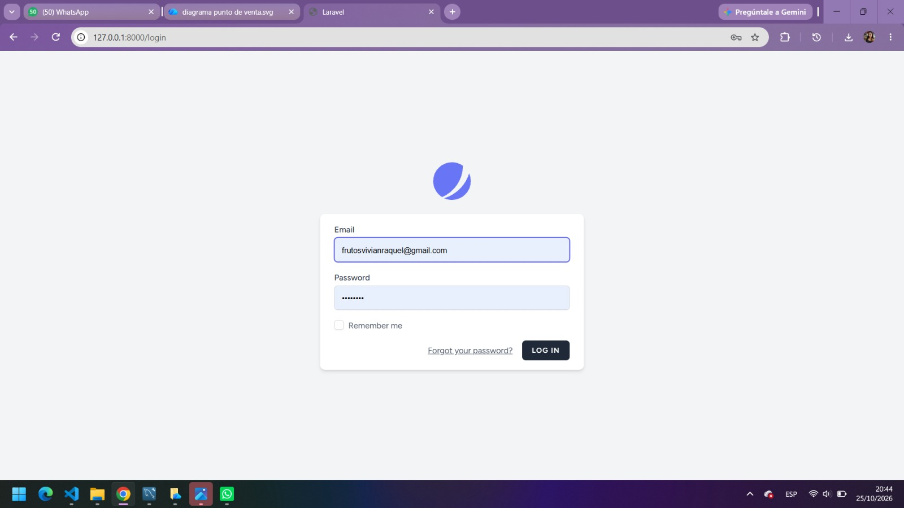

[← Volver al inicio](index.md)

# Entrega 2 · Análisis

> *Qué debe hacer el sistema, desde la perspectiva del negocio y del usuario.*

---

## 1. Requisitos funcionales

| ID | Requisito | Prioridad |
|---|---|---|
| *RF-01* | El sistema debe permitir registrar ventas al contado, calculando automáticamente el total y descontando productos del stock. | Alta |
| *RF-02* | El sistema debe permitir registrar ventas a crédito asociadas a un cliente, actualizando su saldo pendiente. | Alta |
| *RF-03* | El sistema debe permitir la gestión de clientes (registro, consulta de deudas y abonos a libreta). | Alta |
| *RF-04* | El sistema debe permitir la gestión de inventario y productos (altas, bajas, modificación y categorías). | Alta |
| *RF-05* | El sistema debe mostrar alertas visuales cuando un producto alcance su stock mínimo. | Media |
| *RF-06* | El sistema debe emitir reportes o resúmenes de ventas diarias. | Baja |

---

## 2. Requisitos no funcionales

| *RNF-01* | La interfaz debe ser intuitiva y de fácil uso para que el usuario opere el sistema sin capacitación previa. | Usabilidad |
| *RNF-02* | El sistema debe responder a las búsquedas y registros de ventas en menos de 1 segundo en entorno local. | Rendimiento |
| *RNF-03* | Las transacciones de venta deben garantizar la integridad de los datos (soporte ACID en MariaDB). | Fiabilidad |
| *RNF-04* | El sistema debe ejecutarse sobre el entorno local XAMPP sin costo de licencias de software. | Portabilidad / Costo |

---

## 3. Modelo de casos de uso

**Diagrama de casos de uso / flujo principal:**

**Especificación de casos de uso principales:**

#### CU-01 · Registrar Venta al Contado
* *Actor(es):* Ariel (Usuario / Administrador)
* *Precondición:* Existen productos registrados con stock disponible.
* *Flujo principal:*
  1. Ariel selecciona los productos y los agrega al carrito.
  2. El sistema calcula el total de la venta automáticamente.
  3. Ariel selecciona la opción de pago "Contado" y confirma la operación.
  4. El sistema registra la venta y descuenta los productos del stock.
* *Flujos alternativos:*
  * Stock insuficiente: Si la cantidad supera el stock actual, el sistema bloquea el agregado e informa el límite disponible.
* *Postcondición:* Venta registrada y stock de productos actualizado.

#### CU-02 · Registrar Venta a Crédito (Libreta)
* *Actor(es):* Ariel (Usuario / Administrador)
* *Precondición:* El cliente debe estar registrado en el sistema.
* *Flujo principal:*
  1. Ariel agrega los productos solicitados al carrito.
  2. Selecciona la opción de pago "A crédito / Libreta".
  3. Busca y selecciona el cliente correspondiente.
  4. Confirma la operación.
  5. El sistema registra la venta, suma la deuda al cliente y actualiza el stock.
* *Postcondición:* Saldo deudor del cliente actualizado e inventario descontado.

#### CU-03 · Registrar Abono de Deuda
* *Actor(es):* Ariel (Usuario / Administrador)
* *Precondición:* El cliente tiene saldo adeudado registrado.
* *Flujo principal:*
  1. Ariel ingresa al módulo de Clientes y busca al cliente.
  2. Selecciona la opción "Registrar Pago / Abono".
  3. Ingresa el monto entregado por el cliente y confirma.
  4. El sistema resta el monto abonado de la deuda total.
* *Postcondición:* Deuda del cliente reducida correctamente.
---

## 4. Modelo de dominio

**Diagrama de clases conceptual:**

*Descripción de entidades principales:*
* *Cliente:* Guarda datos personales (CI_RUC, Nombre, Apellido, Telefono) y controla la deuda pendiente.
* *Producto:* Contiene Codigo, Nombre, Stock, Precio_Venta y se relaciona con Categoria y Marca.
* *Venta:* Transaction principal que guarda la Fecha, Monto_Total, Tipo_Pago y se vincula con el Cliente y el Vendedor.
* *DetalleVenta (contiene):* Asocia los productos comprados con la cantidad y el precio unitario en el momento de la venta.
* *Proveedor y Compra:* Registran la reposición de inventario e ingreso de mercadería.

## 5. Diagramas de comportamiento

**Diagrama de secuencia / actividad — secuencia — Proceso de Venta:**

*Breve explicación:* Representa el flujo interactivo desde que el vendedor autenticado inicia la atención, busca productos, selecciona la condición de pago (Contado o Crédito) y el sistema procesa la transacción afectando las tablas en MariaDB.

## 6. Prototipo de interfaz (mockups)

### Pantalla — Inicio de Punto de Venta:

*Descripción:* Pantalla principal de bienvenida al punto de venta que permite el ingreso o registro de usuario.

### Pantalla — Acceso al Sistema (Login)

*Descripción:* Formulario de inicio de sesión seguro para la autenticación de usuarios.

### Pantalla — Gestión de Clientes

*Descripción:* Formulario de alta para registrar clientes con su documento, nombre, apellido y teléfono, junto con el listado de clientes registrados.

### Pantalla — Gestión de Categorías

*Descripción:* Panel de administración de categorías de productos (altas, edición y listado) integrado con soporte para tema claro y oscuro en AdminLTE.

### Pantalla — Gestión de Marcas y Proveedores

*Descripción:* Módulos para administrar las marcas de productos y los datos de proveedores (RUC, nombre y teléfono).

---

## 7. Reglas del negocio

| ID | Regla |
|---|---|
| *RN-01* | Toda venta a crédito debe estar asociada obligatoriamente a un cliente registrado en el sistema. |
| *RN-02* | No se permite procesar una venta si la cantidad de un producto supera las existencias actuales de stock. |
| *RN-03* | El monto abonado por un cliente a su cuenta de crédito no puede ser mayor al saldo total adeudado. |
| *RN-04* | Los precios unitarios en el detalle de la venta quedan congelados al momento de registrar la transacción. |
---

## 8. Matriz de trazabilidad

| Requisito | Caso(s) de uso relacionado(s) |
|---|---|
| *RF-01* | CU-01 |
| *RF-02* | CU-02 |
| *RF-03* | CU-03 |
| *RF-04* | CU-01, CU-02 |
| *RF-05* | CU-01 |
| *RF-06* | CU-01, CU-02 |
| RF-03 | CU-01 |

---

[← Anterior: Conceptualización](conceptualizacion.md) · [Siguiente: Diseño →](diseno.md)
