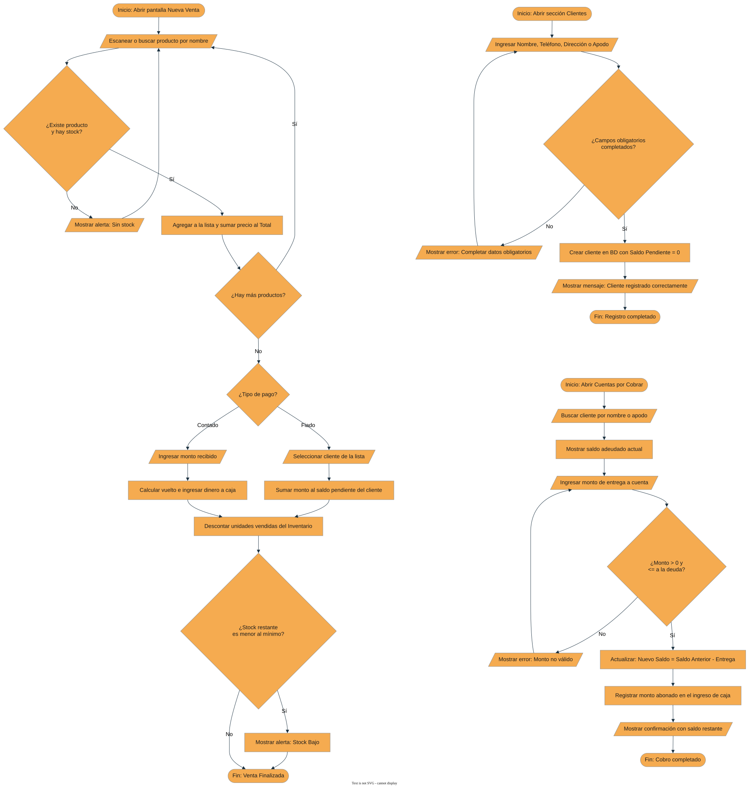
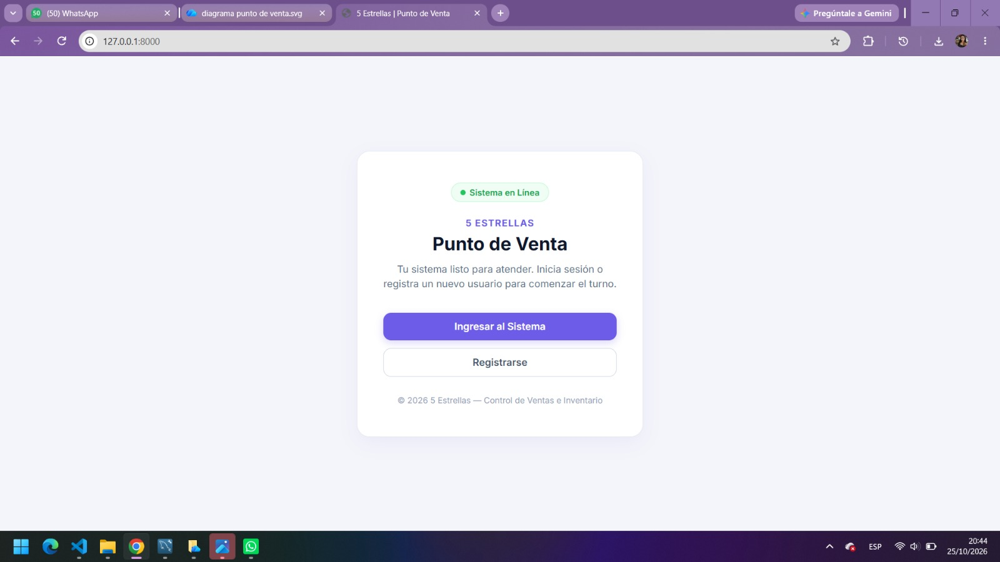
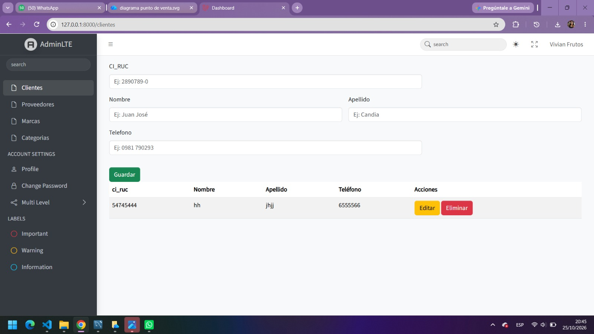
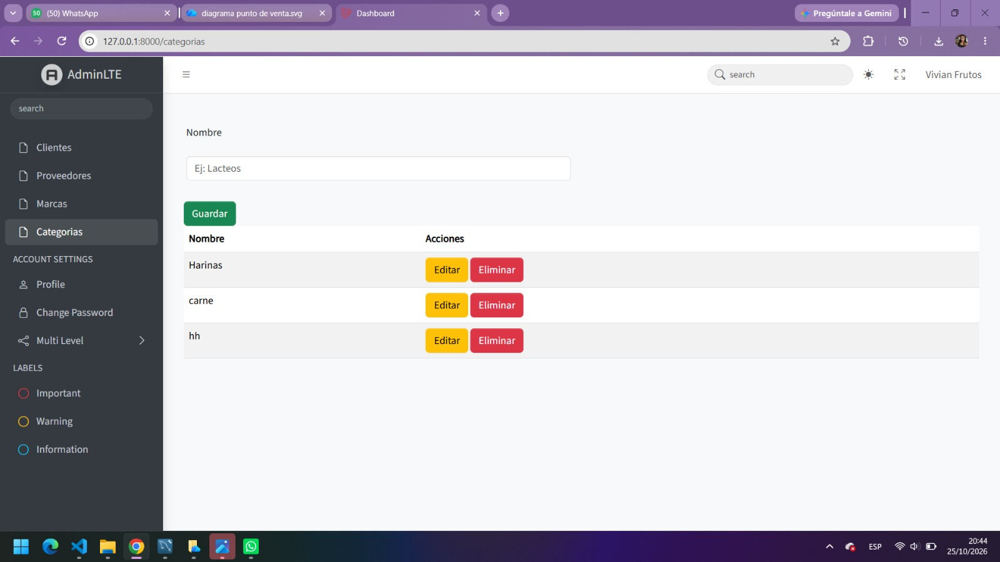
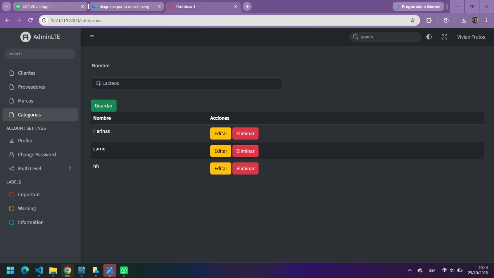
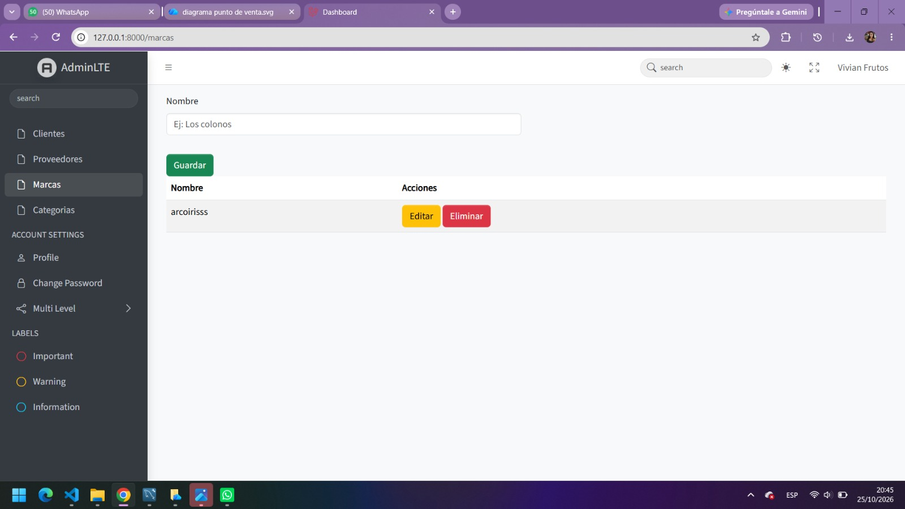
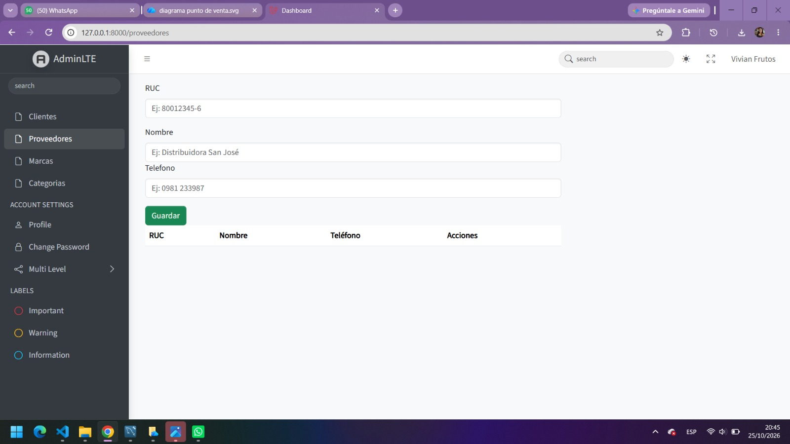

[← Volver al inicio](index.md)

# Entrega 2 · Análisis

> *Qué debe hacer el sistema, desde la perspectiva del negocio y del usuario.*

---

## 1. Requisitos funcionales

| ID | Requisito | Prioridad |
|---|---|---|
| RF-01 | [El sistema debe permitir...] | Alta |
| RF-02 | [El sistema debe permitir...] | Alta |
| RF-03 | [El sistema debe permitir...] | Media |
| RF-04 | [El sistema debe permitir...] | Baja |

---

## 2. Requisitos no funcionales

| ID | Requisito | Categoría |
|---|---|---|
| RNF-01 | [ej. El sistema debe responder en menos de 2s] | Rendimiento |
| RNF-02 | [ej. Las contraseñas deben almacenarse cifradas] | Seguridad |
| RNF-03 | [ej. La interfaz debe ser utilizable sin capacitación previa] | Usabilidad |

---

## 3. Modelo de casos de uso

**Diagrama de casos de uso / flujo principal:**

**Especificación de casos de uso principales:**

### CU-01 · [Nombre del caso de uso]

- **Actor(es):** [actor principal / secundarios]
- **Precondición:** [qué debe cumplirse antes]
- **Flujo principal:**
  1. [Paso 1]
  2. [Paso 2]
  3. [Paso 3]
- **Flujos alternativos:** [qué pasa si algo falla o se desvía]
- **Postcondición:** [estado del sistema al finalizar]

*(Repetir esta estructura para cada caso de uso principal.)*

---

## 4. Modelo de dominio

**Diagrama de clases conceptual:**

[Breve descripción de las entidades principales del negocio y cómo se relacionan entre sí, sin detalles de implementación.]

---

## 5. Diagramas de comportamiento

**Diagrama de secuencia / actividad — secuencia — Proceso de Venta:**

[Breve explicación del flujo representado.]

---

## 6. Prototipo de interfaz (mockups)

### Pantalla — Inicio de Punto de Venta:

*Descripción:* Pantalla principal de bienvenida al punto de venta que permite el ingreso o registro de usuario.

### Pantalla — Acceso al Sistema (Login)

*Descripción:* Formulario de inicio de sesión seguro para la autenticación de usuarios.

### Pantalla — Gestión de Clientes

*Descripción:* Formulario de alta para registrar clientes con su documento, nombre, apellido y teléfono, junto con el listado de clientes registrados.

### Pantalla — Gestión de Categorías

*Descripción:* Panel de administración de categorías de productos (altas, edición y listado) integrado con soporte para tema claro y oscuro en AdminLTE.

### Pantalla — Gestión de Marcas y Proveedores

*Descripción:* Módulos para administrar las marcas de productos y los datos de proveedores (RUC, nombre y teléfono).

---

## 7. Reglas del negocio

| ID | Regla |
|---|---|
| RN-01 | [ej. Un usuario no puede registrar dos reservas superpuestas] |
| RN-02 | [Regla 2] |

---

## 8. Matriz de trazabilidad

| Requisito | Caso(s) de uso relacionado(s) |
|---|---|
| RF-01 | CU-01 |
| RF-02 | CU-02, CU-03 |
| RF-03 | CU-01 |

---

[← Anterior: Conceptualización](conceptualizacion.md) · [Siguiente: Diseño →](diseno.md)
